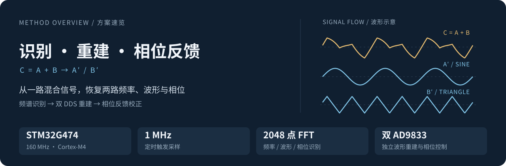
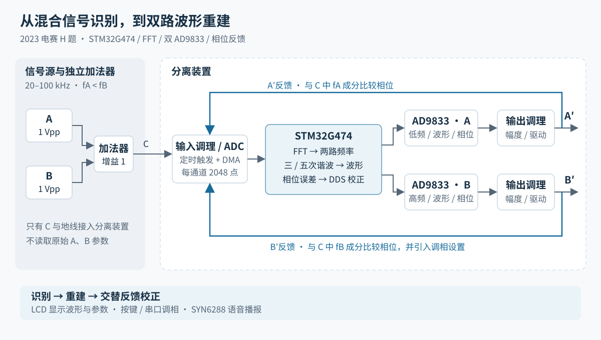
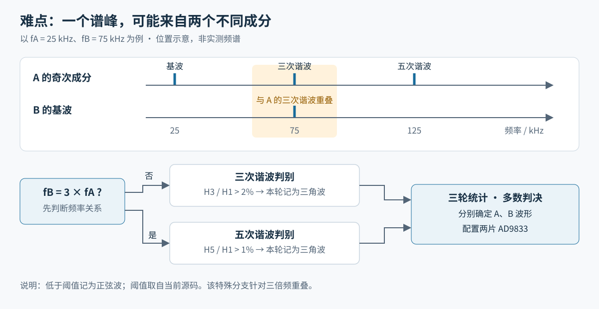

<a id="top"></a>

<div align="center">

# 信号分离装置

### Signal Separation with FFT, Dual DDS & Phase Feedback

[@oyontalas](https://github.com/oyontalas)

**2023 年全国大学生电子设计竞赛 · H 题 · 国家一等奖**

从一路混合信号中，恢复两路信号的频率、波形与相位。<br />
基于 STM32G474 的完整 MCU 工程、算法解析与实体演示。

<a href="https://www.bilibili.com/video/BV11u4y1x7xB"></a>
<a href="docs/2023竞赛题目列表（本科）/H题_信号分离装置.pdf"></a>
<a href="https://github.com/oyontalas/g474_DianSai2023"></a>
<a href="MDK-ARM/g474_DianSai2023.uvprojx"></a>
<a href="https://github.com/oyontalas/g474_DianSai2023/issues"></a>

<sub>STM32G474 &nbsp; · &nbsp; CMSIS-DSP &nbsp; · &nbsp; AD9833 &nbsp; · &nbsp; C / Keil MDK</sub>

[题目与目标](#challenge) · [总体方案](#architecture) · [算法实现](#algorithms) · [工程导航](#repository) · [快速开始](#quick-start)



</div>

---

> **作品亮点**　利用题目的离散频率条件稳定识别基波，以三／五次谐波区分正弦波与三角波，通过双 DDS 重建和交替相位反馈完成输出控制。
>
> **展示与交互**　LCD 波形显示、频率与类型识别、按键调相、串口控制及 SYN6288 语音播报。

<a id="challenge"></a>

## 01 · 题目与目标

输入 A、B 的频率范围为 **20～100 kHz**，满足 **fA < fB**，峰峰值均为 **1 V**。二者经单位增益加法器得到 C，分离装置只能接收 **C 和地线**，不能直接获取 A、B 或通过其他通信取得信号源参数。

分离出的 A′、B′需要保持原信号的波形，峰峰值均不小于 1 V，并能与原信号在示波器上连续、稳定、同频显示。题目的层次是：

- **基础部分**：先分离 50 kHz 与 100 kHz 两路正弦波，再推广到频率为 10 kHz 整数倍的正弦波组合。
- **发挥部分的波形分离**：A、B 可分别为正弦波或三角波，频率步进缩小到 5 kHz。
- **发挥部分的初相位控制**：当两路均为正弦波且 fB 为 fA 的整数倍时，设置 B′相对 A′的初相位，范围 0°～180°，设置分辨率 5°，误差绝对值不超过 5°。
- **自动完成**：参数设置后最多按一次启动键，后续无人工干预，完成时间不超过 20 s。

这些是题目规定的测试条件与指标。下面说明本项目如何围绕这些要求组织方案；输出幅度、失真、相位误差和完成时间以实物测试为准。

<a id="architecture"></a>

## 02 · 总体方案



*方案图依据当前固件整理；图中的输入与输出调理表示模拟链路的功能位置，不代表完整电路原理图。*

题目将输入限定为有限频率集合中的正弦波或三角波，因此可以先从 C 的频谱中识别出两路信号的参数，再由两片 DDS 分别生成 A′、B′。本项目的数字处理分为三个阶段：

1. **参数识别**：采集 C，估计两路基波频率，判断每一路是正弦波还是三角波。
2. **信号重建**：配置两片 AD9833 的频率与波形，分别产生低频 A′和高频 B′。
3. **相位反馈**：重新采集 C 与输出反馈，计算相位误差，持续修正 DDS 相位。

这三个阶段分别处理“分出哪两路”“生成什么波形”和“如何保持稳定显示”的问题。外部加法器负责 C = A + B，输出幅度则由 DDS 后的模拟链路配合实现；仓库中的 MCU 固件主要负责采样、识别与控制。

<a id="algorithms"></a>

## 03 · 算法实现

<details>
<summary><strong>展开：从一帧采样到输出更新的算法流程</strong></summary>

以下为主循环的逻辑摘要，用于对应源码阅读；硬件采样启动、异常分支和显示操作已省略。

```text
DMA 完成一帧采样
  │
  ├─ 拆分两通道：混合信号 C / 当前输出反馈
  ├─ 两组 2048 点 FFT：提取频谱幅度与相位
  ├─ 混合频谱寻峰：排除主峰附近，定位第二成分
  └─ 频率归整：映射到 5 kHz 网格，按低频 / 高频排序
       │
       ├─ 尚未完成识别
       │    ├─ fB ≠ 3fA：三次谐波判别
       │    ├─ fB = 3fA：五次谐波判别
       │    └─ 三轮多数投票 → 更新双 DDS → 显示 / 播报
       │
       └─ 已完成识别
            ├─ 频率组合变化 → 重新识别
            └─ 频率组合不变 → 校正当前输出相位 → 切换反馈通道
```

关键状态位：`system_mode = 4` 选择自动模式，`system_mode_full` 记录识别进度，`adc_mode` 选择 A/B 反馈链路，`phase_diff` 保存调相设置。

</details>

### 1. 利用题目的频率步进，稳定确定两路基波

源码入口：[采样与 FFT](Core/Src/main.c#L408) · [峰值搜索](Core/Src/main.c#L471) · [频率归整](Core/Src/main.c#L552)

STM32G474 运行于 **160 MHz**。TIM8 以 **1 MHz** 的配置触发率驱动 ADC 双通道顺序采样，DMA 每帧收集 4096 个交错数据，拆分后每通道各有 **2048 点**。CMSIS-DSP 完成实数 FFT，对应频率间隔约为：

$$
\Delta f = \frac{f_s}{N} = \frac{1\,000\,000}{2048} \approx 488.28\ \text{Hz}
$$

混合信号的基波定位采用以下步骤：

- 跳过直流位置，寻找幅度最大的谱峰。
- 搜索第二个峰时，排除主峰附近约 **±2.5 kHz** 的范围，降低将同一成分的频谱泄漏误认为另一信号的可能性。
- 将估计频率就近归整到 **5 kHz** 网格，并按频率由低到高分配给 A、B。

这里的 5 kHz 网格来自发挥部分的题目约束，同时覆盖基础部分的 10 kHz 步进。FFT 负责找到频率所在区域，离散频率集合帮助确定 DDS 应输出的标称频率。

### 2. 用谐波识别三角波，处理三倍频重叠

源码入口：[三次谐波判别](Core/Src/main.c#L622) · [五次谐波判别](Core/Src/main.c#L717) · [三轮投票](Core/Src/main.c#L811)

正弦波主要包含基波；理想三角波包含奇次谐波，其幅度相对基波按阶数平方衰减：

$$
\frac{H_3}{H_1} = \frac{1}{9},\qquad
\frac{H_5}{H_1} = \frac{1}{25}
$$

因此，代码在基波的三次谐波附近搜索局部峰值，判断该信号是否具有三角波的谐波特征。当前实现以基波幅度的 **2%** 为三次谐波判别阈值，搜索窗口约为目标频率的 **±2.5 kHz**。

这里有一个题目中特别重要的情况：**fB = 3fA**。例如 A 为 25 kHz、B 为 75 kHz，A 的三次谐波恰好落在 B 的基波上。此时，75 kHz 处存在谱峰并不能证明 A 是三角波。



当前代码针对三倍频组合切换到**五次谐波判别**，阈值改为基波幅度的 **1%**。题目范围内对应的组合包括 20/60、25/75、30/90 kHz。完成三轮分类后，程序以多数结果确定两路波形，再下发给 DDS。

三次、五次谐波的理论比例用于解释判别依据；2%、1% 是当前代码采用的工程阈值，两者并非同一概念。该分支针对三倍频重叠，其他谐波碰撞组合仍应结合测试用例验证。

### 3. 双 DDS 分别重建两路波形

源码入口：[频率控制字](admin/ad9833.c#L178) · [波形配置](Core/Src/main.c#L812)

两片 AD9833 共用 SPI 总线，通过独立片选分别接收配置。程序将低频成分分配给 A′，高频成分分配给 B′，并选择相应的正弦波或三角波输出模式。

驱动按照 **25 MHz** 参考时钟计算 28 位频率控制字：

$$
W_f = \left\lfloor \frac{f_{out}}{25\,000\,000}\,2^{28} \right\rfloor
$$

DDS 承担连续波形生成，MCU 则保留算力用于 FFT、识别和相位控制。改变输入频率组合后，程序会重新识别并更新输出配置。

### 4. 从“标称频率一致”到“稳定同频显示”

源码入口：[反馈相位提取](Core/Src/main.c#L939) · [相位误差与修正](Core/Src/main.c#L958) · [相位寄存器写入](admin/ad9833.c#L201)

题目用原信号 A 触发示波器，要求 A′在显示 4～8 个周期时不漂移。只给 DDS 写入相同的标称频率，不能消除独立时钟和模拟链路带来的相位变化，因此程序还引入了输出反馈。

识别完成后，两组采样链路交替工作：

- **A 路校正**：采集混合信号 C 与 A′反馈，从 C 的频谱中取出 fA 成分的相位，与 A′比较。
- **B 路校正**：采集 C 与 B′反馈，取出 fB 成分的相位，与 B′比较，并在误差计算中加入用户的相位设置。

频谱相位通过 `atan2(Im, Re)` 得到。相位误差折回到约 ±180°，再换算为 DDS 的 12 位相位增量：

$$
\Delta P = \mathrm{trunc}\left(\frac{e_\varphi}{360^\circ}\,4096\right)
$$

其中 `trunc` 表示向零截断，与代码中的整数类型转换一致。

程序将该增量累加到相位寄存器中，并反复交替校正两路。代码还包含随频率变化的补偿项 `1.351 / 10000 × f`（f 以 Hz 计，补偿结果为度），用于补偿链路相位偏差；更换采样条件或模拟电路后需重新标定。

**初相位的定义也需要与题目保持一致。** 当两路频率不同，不能把任意时刻的相位角之差视为题目要求的初相位。题目以 A′为时间基准，定义：

$$
A'(t)=\sin(\omega_A t),\qquad B'(t)=\sin(\omega_B t+\varphi)
$$

本工程通过 B 路相位误差中的 `phase_diff` 设置项实现调相，按键步进为 **5°**，串口还支持 **1°** 的调整步进。设置步进不等于实际误差精度，验收时应按题目定义在示波器上测量 φ。

<a id="repository"></a>

## 04 · 工程导航

**先看 `main.c` 理解算法，再沿外设与驱动向下阅读。** 工程使用 HAL 裸机主循环配合中断，核心入口为 `main()` → `ADMIN_Init()` → `ADMIN_Mainloop()`。

```text
g474_DianSai2023/
├── Core/                          # MCU 初始化与应用核心
│   ├── Inc/                       # 外设接口、引脚及公共定义
│   └── Src/
│       ├── main.c                 # FFT、波形识别、DDS 控制与交互
│       ├── adc.c / dma.c          # 双通道扫描与 DMA 传输
│       ├── tim.c                  # TIM8 采样触发、TIM17 按键扫描
│       ├── spi.c / usart.c        # DDS、LCD 与串口外设配置
│       └── stm32g4xx_it.c         # DMA、定时器、串口中断入口
├── admin/                         # 应用侧硬件驱动
│   ├── ad9833.c / ad9833.h        # DDS 频率、波形与相位设置
│   ├── a_key.c / a_key.h          # 按键扫描与事件识别
│   ├── lcd.c / lcd_init.c         # 显示初始化、字符与波形绘制
│   ├── lcdfont.h / pic.h          # 显示资源
│   └── syn6288.c / syn6288.h      # 语音合成数据帧
├── Drivers/                       # STM32 HAL 与 CMSIS
├── Middlewares/ST/ARM/DSP/         # DSP 头文件与 Cortex-M4 数学库
├── MDK-ARM/                       # Keil 工程、启动文件与构建输出
├── docs/                          # 题目、板卡资料与 README 配图
│   └── images/                    # 可编辑的 SVG 技术图
└── g474_DianSai2023.ioc            # STM32CubeMX 外设配置
```

### 推荐阅读路线

1. **启动与调度**：[main()](Core/Src/main.c#L1622) → [ADMIN_Init()](Core/Src/main.c#L178) → [ADMIN_Mainloop()](Core/Src/main.c#L235)，了解初始化顺序与控制循环。
2. **采样链路**：[ADC 配置](Core/Src/adc.c) → [定时器触发](Core/Src/tim.c) → [DMA 完成中断](Core/Src/stm32g4xx_it.c#L68)，理解一帧数据何时开始、何时交给算法。
3. **算法核心**：沿上一节四个算法的源码入口，阅读寻峰、归整、谐波判别与相位修正。
4. **输出与交互**：[AD9833 驱动](admin/ad9833.c)、[LCD 绘制](admin/lcd.c)、[按键扫描](admin/a_key.c)、[语音播报](admin/syn6288.c)。

<details>
<summary><strong>展开：采样与中断如何协作</strong></summary>

- TIM8 触发 ADC 顺序转换两个通道，DMA 将数据写入交错缓冲区。
- DMA 完成中断停止当前采样，并设置 `adc_buffer_full_flag`。
- 主循环检测标志后拆分数据、执行 FFT，再进入识别或相位反馈分支。
- 处理完成后重新启动下一帧采样；反馈阶段在 ADC1 与 ADC2 之间交替。
- TIM17 每 1 ms 扫描按键，USART1 接收调相与重新识别命令。

单通道每帧的采集时长约为 2.048 ms；FFT、显示和通信会增加帧间间隔，因此该数值不是完整控制周期。

</details>

<a id="quick-start"></a>

## 05 · 快速开始

### 编译与运行

1. 获取工程，并用 Keil 打开 [`MDK-ARM/g474_DianSai2023.uvprojx`](MDK-ARM/g474_DianSai2023.uvprojx)。
2. 按原配置使用 **ARM Compiler 5.06 update 6** 与 `Keil.STM32G4xx_DFP.1.3.0`；HAL、CMSIS 与 DSP 库已包含在仓库中。
3. 执行 Rebuild，通过 SWD 下载程序。默认 `system_mode = 4`，进入自动识别、重建和相位反馈模式。
4. 结合 [板卡资料](docs/) 核对接线与模拟前端；输出波形可参考[实体演示视频](https://www.bilibili.com/video/BV11u4y1x7xB)。

### 操作方式

- **按键**：KEY1 / KEY3 减小 / 增大 5°，KEY2 归零，KEY4 重新识别。
- **串口**：USART1，115200 baud、8N1；发送单个字符 `1` / `2` 增加 / 减小 1°，`3` 归零，`4` 重新识别。
- **显示与播报**：LCD 展示混合波形、两路频率、波形类型与相位设置；SYN6288 播报识别结果。

<details>
<summary><strong>展开：硬件接口速查</strong></summary>

- **采样**：ADC1 为 PC2 / PC3，ADC2 为 PC0 / PC1。按当前算法，两组的第一顺序通道采集 C，第二顺序通道分别采集 A′、B′反馈，实际接线需与模拟链路一致。
- **DDS**：SPI2 使用 PB13 / SCK、PB15 / MOSI；A、B 两路片选分别为 PB11、PB12。驱动按 25 MHz 参考时钟计算频率。
- **LCD**：SPI3 使用 PC10 / SCK、PC12 / MOSI；PC8 / CS、PC7 / DC、PC9 / RES、PC5 / 背光。当前为 320 × 240 横屏。
- **语音**：USART3，PB10 / TX、PC11 / RX，9600 baud、8N1。
- **控制**：USART1，PA9 / TX、PA10 / RX；KEY1～KEY4 对应 PA0～PA3。
- **调试**：PA13 / SWDIO、PA14 / SWCLK。

</details>

<details>
<summary><strong>展开：调试模式与修改提示</strong></summary>

`system_mode` 保留五种模式：`0` / `1` 分别输出 ADC1 原始数据 / FFT 幅度，`2` / `3` 对应 ADC2，`4` 为自动模式。调试数据从 USART1 以逗号分隔的文本行发送；当前按键用于调相，切换模式需修改变量或增加入口。

部分源文件采用 GBK 类编码，编辑中文语音字符串时应保持编码一致。修改 CubeMX 配置后，应检查自定义 DMA 中断和 DSP 库配置是否保留。仓库含历史 AXF / HEX，修改源码后请重新构建。

</details>

<a id="contributing"></a>

## 06 · 交流与贡献

欢迎通过 [Issues](https://github.com/oyontalas/g474_DianSai2023/issues) 交流复现经验、算法改进和测试结果，也欢迎提交改进代码或文档的 Pull Request。

反馈识别或相位问题时，附上 **A/B 频率与波形、输入幅度、目标相位、硬件版本以及示波器截图**，更方便定位与复现。

---

<div align="center">

**2023 全国大学生电子设计竞赛 · H 题 · 国家一等奖**

[实体演示](https://www.bilibili.com/video/BV11u4y1x7xB) · [题目原文](docs/2023竞赛题目列表（本科）/H题_信号分离装置.pdf) · [返回顶部](#top)

</div>
